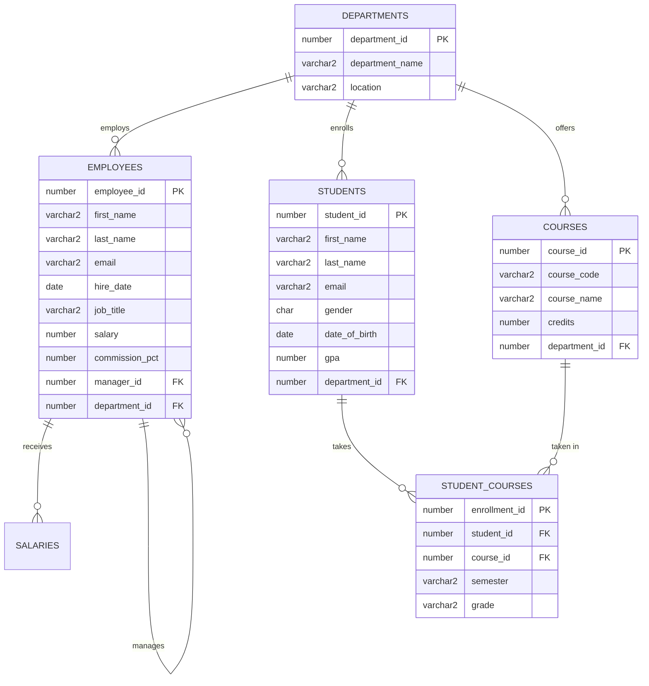

# Complete SQL Learning & Practice Workspace

Welcome to my **SQL Learning & Practice Workspace**. This repository is structured to document my learning journey from absolute database basics to advanced multi-table joins and correlated subqueries using standard ANSI SQL and Oracle SQL syntax.

---

## 📂 Workspace Structure

```text
SQL/
│
├── README.md                           # Master Guide, Roadmap, and Progress Checklist
│
├── Notes/                              # Comprehensive Concept & Theory Guides
│   ├── 01_SQL_Introduction.md          # Databases, RDBMS, Tables, and SQL Command Types
│   ├── 02_Database_and_Table_Basics.md # Schemas, Tables, Metadata (DESC), and Relationships
│   ├── 03_Data_Types_and_Constraints.md# NUMBER, VARCHAR2, DATE, PK, FK, UNIQUE, CHECK
│   ├── 04_CREATE_and_DROP.md           # DDL: CREATE, ALTER, RENAME, TRUNCATE, DROP
│   ├── 05_INSERT_UPDATE_DELETE.md      # DML: INSERT, UPDATE, DELETE, COMMIT, ROLLBACK
│   ├── 06_SELECT_and_Aliases.md        # Column Projection, Aliases, Concatenation, DISTINCT
│   ├── 07_WHERE_Operators_and_Filters.md# Comparison, AND/OR/NOT, BETWEEN, IN, LIKE, IS NULL
│   ├── 08_SORTING_and_DISTINCT.md      # ORDER BY, Multi-Column Sort, NULLS FIRST/LAST
│   ├── 09_SQL_Functions.md             # String, Math, Date, NVL/COALESCE, Aggregates, CASE
│   ├── 10_GROUP_BY_and_HAVING.md       # Grouping, Aggregates, HAVING vs WHERE, ORA-00979
│   ├── 11_JOINS.md                     # INNER, LEFT, RIGHT, FULL, CROSS, SELF, 3+ Tables
│   ├── 12_SUBQUERIES.md                # Single-Row, Multi-Row, Inline Views, Correlated, EXISTS
│   └── 13_SQL_Revision_Cheatsheet.md   # Syntax Templates, Matrices, Pitfalls & Interview Q&A
│
├── Practice/                           # Executable SQL Practice Worksheets
│   ├── 01_Basic_SQL_Queries.sql        # 10 Questions on Projection, DUAL, Metadata
│   ├── 02_DDL_and_Constraints.sql      # 10 Questions on CREATE, ALTER, Constraints, TRUNCATE
│   ├── 03_DML_Queries.sql              # 10 Questions on INSERT, UPDATE, DELETE, Transactions
│   ├── 04_SELECT_and_Filtering.sql     # 10 Questions on WHERE, BETWEEN, IN, LIKE, Dates
│   ├── 05_Functions_and_Aggregates.sql # 10 Questions on Character, Date, NVL, Aggregates, CASE
│   ├── 06_GROUP_BY_and_HAVING.sql      # 10 Questions on Summaries, HAVING thresholds
│   ├── 07_JOINS_Practice.sql           # 10 Questions on INNER, LEFT, RIGHT, FULL, SELF Joins
│   ├── 08_SUBQUERIES_Practice.sql      # 10 Questions on Scalar, Correlated, EXISTS, 2nd Highest
│   └── 09_Mixed_Practice_Questions.sql # 25 Comprehensive Challenge Questions + Solutions
│
└── Practice/Data/
    └── sample_schema.sql               # Reusable Database Schema & Realistic Test Records
```

---

## 🗄️ Sample Database Schema Overview

The workspace includes a sample schema located in [`Practice/Data/sample_schema.sql`](file:///c:/GitHub/SQL/Practice/Data/sample_schema.sql):



### Loading the Sample Schema

#### In Oracle SQL Developer or VS Code Oracle Extension:
1. Connect to your database.
2. Open [`Practice/Data/sample_schema.sql`](file:///c:/GitHub/SQL/Practice/Data/sample_schema.sql).
3. Run as Script (`F5`).

#### In SQL*Plus or Command Line:
```sql
@Practice/Data/sample_schema.sql
```

---

## 🗺️ Learning Roadmap & Recommended Study Plan

| Day | Focus Area | Notes to Read | Practice Worksheet |
| :---: | :--- | :--- | :--- |
| **Day 1** | Foundations & Table Architecture | [01_SQL_Introduction.md](file:///c:/GitHub/SQL/Notes/01_SQL_Introduction.md)<br>[02_Database_and_Table_Basics.md](file:///c:/GitHub/SQL/Notes/02_Database_and_Table_Basics.md) | [01_Basic_SQL_Queries.sql](file:///c:/GitHub/SQL/Practice/01_Basic_SQL_Queries.sql) |
| **Day 2** | Schemas, Constraints & DDL | [03_Data_Types_and_Constraints.md](file:///c:/GitHub/SQL/Notes/03_Data_Types_and_Constraints.md)<br>[04_CREATE_and_DROP.md](file:///c:/GitHub/SQL/Notes/04_CREATE_and_DROP.md) | [02_DDL_and_Constraints.sql](file:///c:/GitHub/SQL/Practice/02_DDL_and_Constraints.sql) |
| **Day 3** | Data Modification & Safe Transactions | [05_INSERT_UPDATE_DELETE.md](file:///c:/GitHub/SQL/Notes/05_INSERT_UPDATE_DELETE.md) | [03_DML_Queries.sql](file:///c:/GitHub/SQL/Practice/03_DML_Queries.sql) |
| **Day 4** | Projection, Expressions & WHERE Filters | [06_SELECT_and_Aliases.md](file:///c:/GitHub/SQL/Notes/06_SELECT_and_Aliases.md)<br>[07_WHERE_Operators_and_Filters.md](file:///c:/GitHub/SQL/Notes/07_WHERE_Operators_and_Filters.md) | [04_SELECT_and_Filtering.sql](file:///c:/GitHub/SQL/Practice/04_SELECT_and_Filtering.sql) |
| **Day 5** | Sorting, DISTINCT & Functions | [08_SORTING_and_DISTINCT.md](file:///c:/GitHub/SQL/Notes/08_SORTING_and_DISTINCT.md)<br>[09_SQL_Functions.md](file:///c:/GitHub/SQL/Notes/09_SQL_Functions.md) | [05_Functions_and_Aggregates.sql](file:///c:/GitHub/SQL/Practice/05_Functions_and_Aggregates.sql) |
| **Day 6** | Group Aggregations & Thresholds | [10_GROUP_BY_and_HAVING.md](file:///c:/GitHub/SQL/Notes/10_GROUP_BY_and_HAVING.md) | [06_GROUP_BY_and_HAVING.sql](file:///c:/GitHub/SQL/Practice/06_GROUP_BY_and_HAVING.sql) |
| **Day 7** | Relational Table Joins | [11_JOINS.md](file:///c:/GitHub/SQL/Notes/11_JOINS.md) | [07_JOINS_Practice.sql](file:///c:/GitHub/SQL/Practice/07_JOINS_Practice.sql) |
| **Day 8** | Subqueries & Existence Tests | [12_SUBQUERIES.md](file:///c:/GitHub/SQL/Notes/12_SUBQUERIES.md) | [08_SUBQUERIES_Practice.sql](file:///c:/GitHub/SQL/Practice/08_SUBQUERIES_Practice.sql) |
| **Day 9** | Mixed Challenge & Interview Review | [13_SQL_Revision_Cheatsheet.md](file:///c:/GitHub/SQL/Notes/13_SQL_Revision_Cheatsheet.md) | [09_Mixed_Practice_Questions.sql](file:///c:/GitHub/SQL/Practice/09_Mixed_Practice_Questions.sql) |

---

## 🎯 Progress Checklist

Mark items as you complete reading each note and executing each practice script:

- [ ] **Chapter 01**: SQL & Database Introduction
- [ ] **Chapter 02**: Database and Table Basics
- [ ] **Chapter 03**: Data Types and Constraints
- [ ] **Chapter 04**: CREATE, ALTER, DROP, TRUNCATE
- [ ] **Chapter 05**: INSERT, UPDATE, DELETE & Transactions
- [ ] **Chapter 06**: SELECT, Column Aliases & Expressions
- [ ] **Chapter 07**: WHERE Operators, Wildcards & Filtering
- [ ] **Chapter 08**: Sorting with ORDER BY & DISTINCT
- [ ] **Chapter 09**: String, Date, Math, NVL & CASE Functions
- [ ] **Chapter 10**: GROUP BY & HAVING
- [ ] **Chapter 11**: INNER, OUTER, CROSS & SELF Joins
- [ ] **Chapter 12**: Subqueries (Single, Multi, Correlated, EXISTS)
- [ ] **Chapter 13**: Master Cheatsheet & Interview Review
- [ ] **Practice 01**: Basic Queries
- [ ] **Practice 02**: DDL & Constraints
- [ ] **Practice 03**: DML & Transactions
- [ ] **Practice 04**: SELECT & Filtering
- [ ] **Practice 05**: Functions & Aggregates
- [ ] **Practice 06**: GROUP BY & HAVING
- [ ] **Practice 07**: Joins Practice
- [ ] **Practice 08**: Subqueries Practice
- [ ] **Practice 09**: 25 Mixed Challenge Questions Solved

---

## 💡 Key Oracle SQL Dialect Differences to Remember

1. **`VARCHAR2` vs `VARCHAR`**: Always use `VARCHAR2` in Oracle. `VARCHAR` is currently reserved for future enhancements.
2. **Date Storage**: In Oracle, `DATE` contains both date and time (year, month, day, hour, minute, second).
3. **The `DUAL` Dummy Table**: When selecting a literal calculation or function without querying a physical table, Oracle requires `FROM DUAL` (e.g., `SELECT SYSDATE FROM DUAL;`).
4. **`NVL` vs `IFNULL`**: Oracle uses `NVL(col, default)` or `COALESCE(...)`. `IFNULL` is MySQL-specific.
5. **NULL Sorting**: In Oracle, `NULL` values sort as the highest value (`NULLS LAST` for `ASC`, `NULLS FIRST` for `DESC` by default). Use explicit clauses to adjust.
6. **DDL Auto-Commit**: All DDL statements (`CREATE`, `ALTER`, `TRUNCATE`, `DROP`) commit automatically. DML statements (`INSERT`, `UPDATE`, `DELETE`) require an explicit `COMMIT;`.

---

> [!NOTE]
> **Next Phase (Advanced Topics)**: Advanced topics such as Window Analytical Functions (`ROW_NUMBER`, `RANK`, `DENSE_RANK`, `LEAD`, `LAG`), Common Table Expressions (`WITH` CTEs), Stored Procedures, Functions, Triggers, Views, and Query Performance Optimization will be added in Phase 2 of this workspace.
